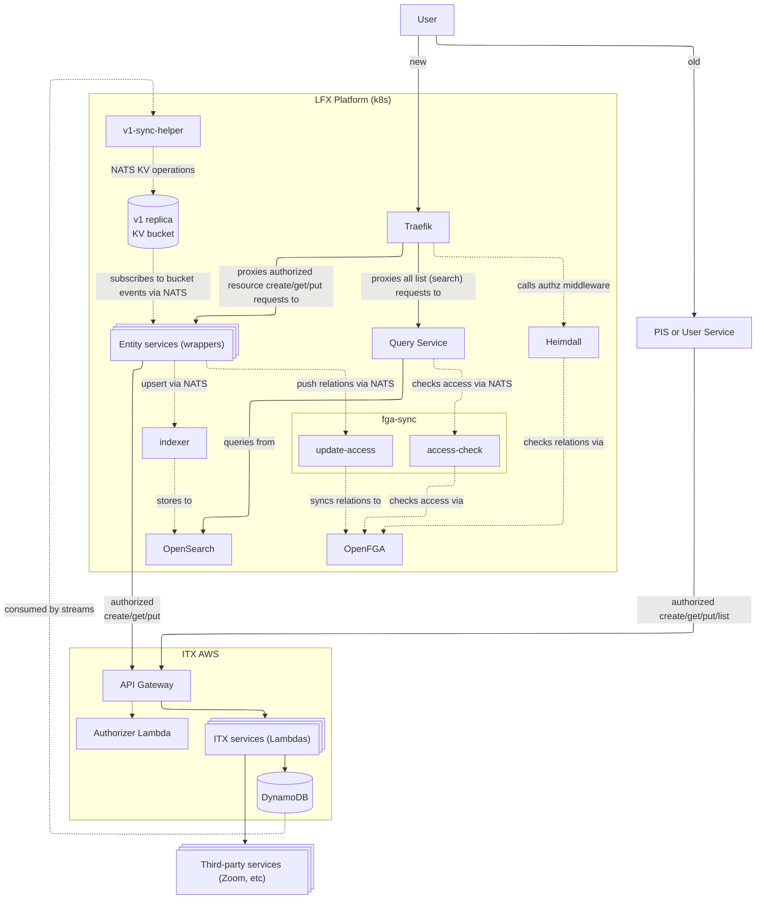
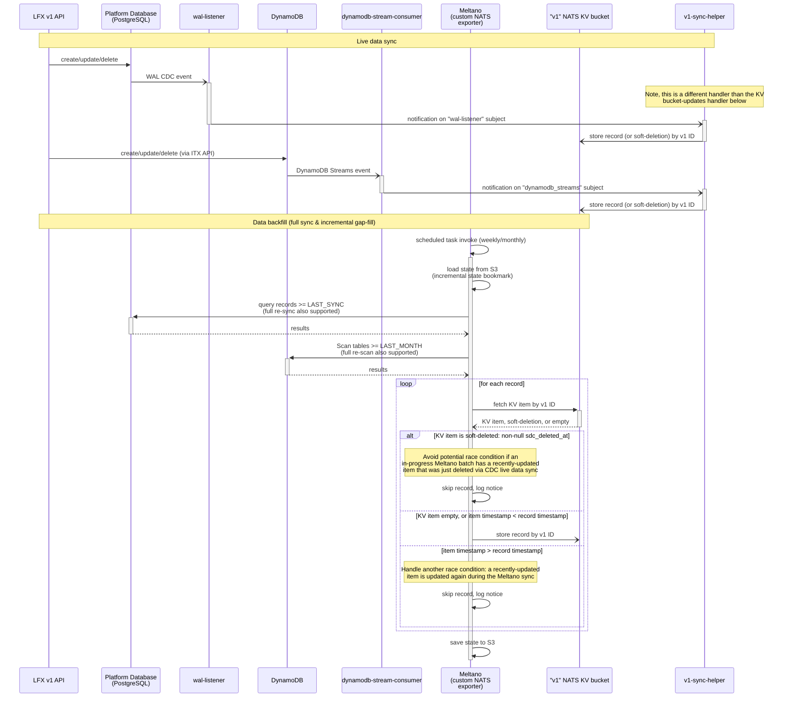
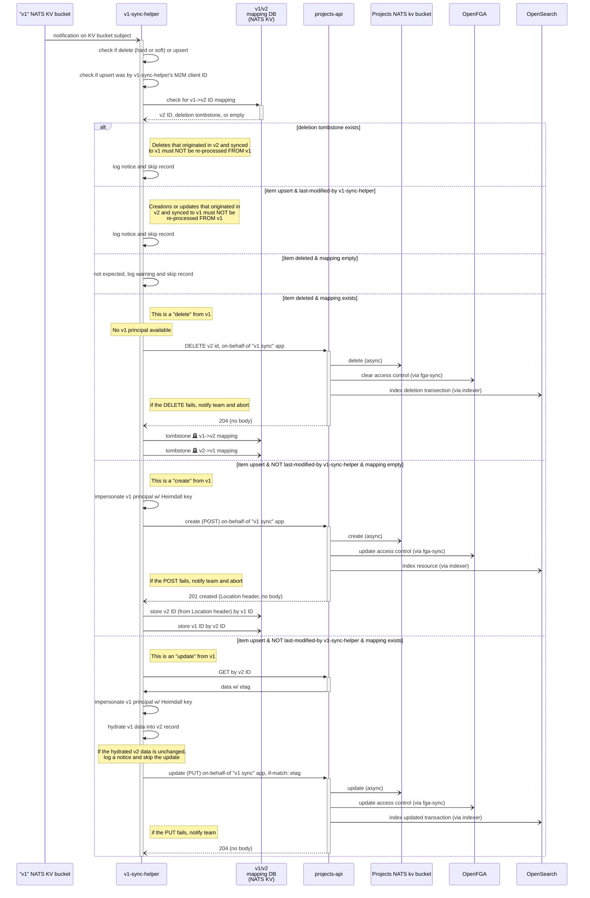
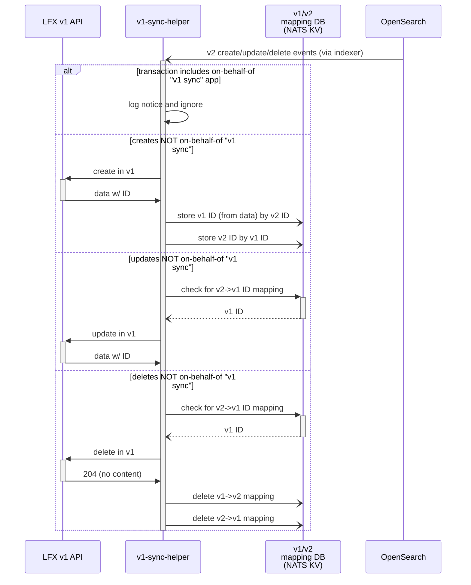

# Data sync components for LFX One

This repository contains tools and services for synchronizing data between LFX v1 and LFX One (v2) platforms. This solution uses Meltano for data extraction and loading, a WAL listener for real-time PostgreSQL change streaming, and a sync helper service that handles data mapping and ingestion into the v2 ecosystem.

## Overview

This repository serves two distinct purposes:

1. **Real-time streaming replication.** PostgreSQL WAL events (via `wal-listener`) and DynamoDB Streams are replicated in real time—alongside periodic Meltano backfills—into a `v1-objects` NATS KV bucket. LFX One wrapper services subscribe to this bucket to drive indexing pipelines (OpenSearch via the indexer service) and access-control pipelines (OpenFGA via fga-sync), without needing to integrate directly with ITX eventing.

2. **Bidirectional sync for "core" resources.** Projects and committees are fully synced in both directions between LFX v1 and LFX One. This gives LFX One a self-contained stack for these entity types, which simplifies developer environment stand-up by removing the dependency on the highly-interconnected LFX/Salesforce/ITX stack.

ITX-hosted resources such as Meetings are handled by v2 "wrapper" services that sit in front of the ITX APIs and rely on the NATS KV replication above for eventing; they do **not** get their own native v2 entity storage. See the [ITX wrappers component diagram](#itx-wrappers-component-diagram) in the Architecture Diagrams section for how this fits together.

## Prerequisites

- Python 3.12 (managed automatically by uv)
- `uv` package manager installed
- Access to LFX v1 data sources (DynamoDB, PostgreSQL)
- LFX One platform running [via Helm](https://github.com/linuxfoundation/lfx-v2-helm/tree/main/charts/lfx-platform#readme)

Please see each component for further setup instructions.

## Repository structure

This repository contains three main components:

### [Meltano](./meltano/README.md)

Data extraction and loading pipeline that extracts data from LFX v1 sources (DynamoDB for meetings, PostgreSQL for projects/committees) and loads it into NATS KV stores for processing by the v2 platform.

### [v1-sync-helper](./cmd/lfx-v1-sync-helper/README.md)

Go service that monitors NATS KV stores for replicated v1 data and synchronizes it with the LFX v2 platform APIs, handling data transformation and conflict resolution.

### [Helm charts](./charts/lfx-v1-sync-helper/README.md)

Kubernetes deployment manifests for the custom app service and WAL listener component, providing scalable deployment options for production environments.

## Research & guides

- [Adding a new DynamoDB table](./research/adding-dynamodb-table.md) — step-by-step checklist for onboarding a new DynamoDB table into the Meltano pipeline and stream consumer, with a worked example.
- [Updating the Meltano catalog ConfigMap](./research/updating-meltano-catalog.md) — how to regenerate and apply the schema cache when tables or columns change.

## NATS API

The v1-sync-helper service provides a NATS request/reply function for querying v1-v2 ID mappings.

### Request/Reply Subject

| Subject                 | Description                                 |
|-------------------------|---------------------------------------------|
| `lfx.lookup_v1_mapping` | Bidirectional v1↔v2 mapping lookup function |

### Usage

Send a NATS request to `lfx.lookup_v1_mapping` with the mapping key as the payload. The service will respond with the corresponding mapping value or an error.

**Request Format:**

```
Subject: lfx.lookup_v1_mapping
Payload: <mapping_key>
```

**Response Format:**

- **Success**: The mapped value as a string
- **Not Found**: Empty string (`""`)
- **Error**: String prefixed with `"error: "` (e.g., `"error: connection timeout"`)

### Available Lookup Patterns

**Note**: While called "sfid", v1 committees and committee members actually store UUIDs in their "sfid" column, so references to `{*_sfid}` for these entities will contain UUIDs.

The following table shows the supported mapping key patterns and their expected response formats:

| Direction | Lookup Key Pattern | Example Key | Response Format | Description |
| ----------- | ------------------- | ------------- | ----------------- | ------------- |
| **Projects** |
| v1→v2 | `project.sfid.{v1_sfid}` | `project.sfid.a0941000002wBjEAAU` | `{v2_uuid}` | Project SFID to UUID |
| v2→v1 | `project.uid.{v2_uuid}` | `project.uid.123e4567-e89b-12d3-a456-426614174000` | `{v1_sfid}` | Project UUID to SFID |
| **Committees** |
| v1→v2 | `committee.sfid.{v1_sfid}` | `committee.sfid.123e4567-e89b-12d3-a456-426614174003` | `{v2_uuid}` | Committee SFID to UUID |
| v2→v1 | `committee.uid.{v2_uuid}` | `committee.uid.123e4567-e89b-12d3-a456-426614174001` | `{project_sfid}:{committee_sfid}` | Committee UUID to compound SFID |
| **Committee Members** |
| v1→v2 | `committee_member.sfid.{v1_sfid}` | `committee_member.sfid.123e4567-e89b-12d3-a456-426614174004` | `{committee_uuid}:{member_uuid}` | Member SFID to compound UUID |
| v2→v1 | `committee_member.uid.{v2_member_uuid}` | `committee_member.uid.123e4567-e89b-12d3-a456-426614174002` | `{project_sfid}:{committee_sfid}:{member_sfid}` | Member UUID to compound SFID |

### User SFID Lookup API

The service also provides NATS request/reply functions for resolving v1 platform user SFIDs by username or email. These lookups query the v1 platform PostgreSQL database live, so results always reflect current data.

| Subject | Description |
|---------|-------------|
| `lfx.lookup_v1_user_sfid.by_username` | Lookup v1 user SFID by username |
| `lfx.lookup_v1_user_sfid.by_email` | Lookup v1 user SFID by email |

**Request Format:**

```
Subject: lfx.lookup_v1_user_sfid.by_username
Payload: <username>

Subject: lfx.lookup_v1_user_sfid.by_email
Payload: <email>
```

**Response Format:**

- **Success**: The v1 user SFID as a string
- **Not Found**: Empty string (`""`) — includes stale index detection
- **Error**: String prefixed with `"error: "` (e.g., `"error: connection timeout"`)

**Notes:**

- Lookups query `salesforce.merged_user` and `salesforce.alternate_email__c` directly with case-insensitive, whitespace-trimmed matching
- If a username/email does not resolve to a live (non-deleted) record, the lookup returns an empty string (miss)
- Callers send raw UTF-8 usernames and emails; the service normalizes (trim, lowercase, NFC) internally

## Backfill / Reindex

**ACS grant backfill (`--backfill-acs-project` / `--backfill-acs-org`):**

Two independent flags are available:

- `--backfill-acs-project` — merges ACS user grants into v2 project settings (`Writers`, `Auditors`, `MeetingCoordinators`).
- `--backfill-acs-org` — merges ACS org grants into v2 `b2b_org` settings (Writers/Auditors). Requires `MEMBER_SERVICE_URL`.

Both flags are additive-only (existing v2 entries are never removed), support `--dry-run` to preview without writing, and are idempotent. The flags are mutually exclusive — run each as a separate Job invocation. Requires full service credentials (Auth0, Heimdall, `PROJECT_SERVICE_URL`; `MEMBER_SERVICE_URL` for the org pass).

In production, apply the Job manifest manually (not ArgoCD-managed). A dry-run pass is recommended first — add `--dry-run` to the manifest args, apply, inspect logs, then re-apply without it:

```sh
kubectl --context lfx-v2-prod -n v1-sync-helper apply -f manifests/backfill-acs-job.yaml
```

Locally (with NATS and member-service port-forwarded):

```sh
lfx-v1-sync-helper --backfill-acs-project [--dry-run]
lfx-v1-sync-helper --backfill-acs-org [--dry-run]
```

**Committee-member reverse-mapping repair (`--backfill-committee-member-mappings`):**

Repairs committee-member reverse mappings (`committee_member.uid.*` in `v1-mappings`) that store the `platform-community__c` record sfid instead of the contact SFID (v1 API "MemberID") — the root cause of v1 committee-member deletes 404ing and leaving members on the committee / meeting invites (LFXV2-2673). Resolves the contact SFID from the `v1-objects` KV bucket; makes no calls to any other service. Writes are optimistic-concurrency guarded against the live sync-helper, idempotent, and safe to re-run.

Run once after deploying the fix, to repair already-affected mappings. A dry-run pass is recommended first:

```sh
kubectl --context lfx-v2-prod -n v1-sync-helper apply -f manifests/backfill-committee-member-mappings-job.yaml
```

Add `--dry-run` to the manifest args, apply, inspect logs (`inspected`/`poisoned`/`fixed`/`already_ok`/`unresolved`/`malformed`/`tombstoned`/`conflicted` counts), then re-apply without it for the live run.

Locally (with NATS port-forwarded):

```sh
lfx-v1-sync-helper --backfill-committee-member-mappings [--dry-run]
```

**Unmapped-project backfill (`--backfill-projects`):**

Re-emits v1 projects that have no v2 mapping (LFXV2-3220 removed the project allowlist, so projects created before 17 Aug 2026 and never modified since were never synced) by re-PUTting the existing `v1-objects` value and letting the running deployment's KV consumer create them. Because that consumer unconditionally ACKs project messages and hard-errors when a parent's mapping is missing, this backfill re-emits parent-before-child, level by level, rather than in one flat pass. Requires only NATS (`NATS_URL`, `AUTH0_CLIENT_ID`) — it makes no v2 API calls itself.

Formation-staged projects are scoped separately by default: a live run refuses to start if it finds Formation-staged candidates unless `--exclude-stage-prefix`, `--include-stage-prefix`, or `--allow-formation` is passed, so the two populations are never silently mixed into one run.

```sh
kubectl --context lfx-v2-prod -n v1-sync-helper apply -f manifests/backfill-projects-job.yaml
```

Add `--dry-run` to the manifest args first, apply, inspect logs (`scanned`/`candidates`/`emitted`/`levels`/`formation_candidates`/`remaining_unmapped` counts), then run the exclude-Formation pass without it:

```sh
lfx-v1-sync-helper --backfill-projects --exclude-stage-prefix Formation --check-slugs [--dry-run]
```

The include-Formation pass bulk-creates checklists in `lfx-v2-formation-service` on first sync, so do not run it until lfx-self-serve#1957's "re-emitting a create event for a project that already has a checklist creates nothing" acceptance criterion is confirmed and the dry-run's `formation_candidates` count has been shared with the Formation team:

```sh
lfx-v1-sync-helper --backfill-projects --include-stage-prefix Formation --check-slugs [--dry-run]
```

**Mapped-project classifications backfill (`--backfill-project-classifications`):**

Reconciles v1 `industry__c`, `technology__c` and `technical_activity_type__c` into the three v2 project-base arrays for already-mapped projects. Unlike `--backfill-projects`, it does not re-emit project creates: it fetches base+ETag and writes only changed classifications while round-tripping other base fields. Live writes use the v1→v2 pending marker to suppress the indexer reverse-sync echo. Missing/malformed v1 columns are preserved; an empty v1 classification never bulk-clears a populated v2-only value (`v2_only_conflicts` requires separate review). Live v1 edits and deliberate clears are handled by the normal sync path.

For v2→v1 clears, the helper sends v1's `"None"` selection: the v1 PATCH repository ignores `[]` but stores an empty column for `"None"`. A v2 `null` classification means unbackfilled/unknown and is never sent as a clear. Conversely an empty or `"None"` v1 column becomes an empty v2 array. Backfill conflicts are logged by project UID and field without logging classification values.

Run only **after** the project-service classification fields are merged, released and deployed, and after the sync-helper version with this job is deployed. Requires KV-authoritative `v1-mappings` (the job refuses postgres-only mapping mode), the `v1-objects` bucket, and the project's Goa/JWT client. Avoid concurrent PCC/Self Serve classification edits while running, since the v1 replica can lag; the job re-reads each v1 record before a write and skips changed values. Dry-run first; `--limit` caps successful writes, and reruns skip equal values. Review `scanned`, `mapped`, `changed`, `updated`, `v2_only_conflicts` and `errors`; verify via both APIs afterward. Do not treat the unmapped-project creation backfill as a substitute for this job.

For an in-cluster one-shot, `manifests/backfill-project-classifications-job.yaml` starts in dry-run mode. Before applying it, pin the released image digest and set the target environment's Heimdall client ID and endpoints. Do not apply a manifest with its placeholder values or enable live mode until dry-run counters are reviewed.

```sh
lfx-v1-sync-helper --backfill-project-classifications --dry-run
lfx-v1-sync-helper --backfill-project-classifications --limit 1000 --emit-rate 2
```

**Unmapped-committee backfill (`--backfill-committees`):**

Re-emits v1 committees that have no v2 mapping, by re-PUTting the existing `v1-objects` value and letting the running deployment's KV consumer create them. `handleCommitteeUpdate` permanently drops (ACKs, no redelivery) a committee create whose parent project has no live mapping — the same bug pattern as the project backfill above, but with a single dependency (parent project) rather than two. Run this after `--backfill-projects` has completed and settled; a candidate whose parent project is still unmapped is reported as `skipped_parent_unmapped` rather than resolved. Requires only NATS (`NATS_URL`, `AUTH0_CLIENT_ID`) — it makes no v2 API calls itself.

`--check-committee-names` skips candidates whose project UID + name already resolves to a v2 committee via NATS `lfx.committee-api.name_to_uid` (`lfx-v2-committee-service` PR #209) — a lost-mapping case that needs a mapping repair, not a duplicate create.

**Prerequisite**: `lfx-v2-committee-service` PR #209 must be merged and deployed to the target environment before this job is run. `--check-committee-names` is on by default in the shipped manifest, and without the `name_to_uid` subject that PR adds, every lookup gets "no responders" and the job (including a dry run) hard-errors before reporting any counters.

```sh
kubectl --context lfx-v2-prod -n v1-sync-helper apply -f manifests/backfill-committees-job.yaml
```

Apply the manifest as shipped (`--dry-run` and `--check-committee-names` are on by default), inspect logs (`scanned`/`candidates`/`emitted`/`remaining_unmapped`/`skipped_name_conflict` counts), then delete the completed dry-run Job, remove `--dry-run` from its `args`, and apply again for the live run — `kubectl apply` on an existing Job whose pod template changed is rejected with `field is immutable`:

```sh
kubectl --context lfx-v2-prod -n v1-sync-helper delete job backfill-committees
```

Locally:

```sh
lfx-v1-sync-helper --backfill-committees --check-committee-names [--dry-run]
```

## Architecture Diagrams

Regarding the following sequence diagrams:

- "Projects API" is representative of the core resources that have bidirectional sync (projects, committees). ITX-hosted resources such as Meetings are handled by wrapper services that subscribe to the NATS KV bucket instead—see the component diagram below.

### ITX wrappers component diagram

This diagram shows how the LFX One platform, the v1-sync-helper replication pipeline, and ITX-hosted services fit together at the component level.



### Data extraction/replication sequence diagram



### LFX One data-loading sequence diagram



### LFX One to v1 bidirectional sync

Implemented for **projects**, **committees**, **committee members**, and **project staff**. The v1-sync-helper subscribes to indexer domain events (`lfx.project.*`, `lfx.committee.*`, `lfx.committee_member.*`) published after every successful OpenSearch write and mirrors the change to the v1 API — projects via the Project Service v1 API (`/project-service/v1/projects`), committees and members via the Project Service v2 API. Project staff uses a separate projects-api event subscription; see below.

Loop detection: if a non-tombstoned reverse mapping already exists for the v2 object, the event originated from v1 and the create is skipped to prevent duplicate v1 records. On the update and delete paths the loop is broken on the v1 side by `shouldSkipSync`, which detects v1 records whose `lastmodifiedbyid` matches the v1-sync-helper's own Auth0 client ID.

#### Project staff sync (GH-1802)

When `V2_TO_V1_PROJECT_STAFF_SYNC_ENABLED=true`, the service also subscribes to `lfx.projects-api.project_settings.updated` (published by project-service on every settings write, with before/after snapshots) and pushes `executive_director` / `program_manager` changes back to the v1 platform via `PATCH {LFX_API_GW}project-service/v1/projects/{sfid}` — the same v1 contract PCC's own staff edit dialog uses, including `"None"` to clear an assignment. This is the return path for the LFX One staff dialog (lfx-self-serve `PUT /projects/{uid}/staff`, which edits one role per save).

Only the roles that actually changed in the event are sent. The v1 PATCH is partial (PCC's other project dialogs send disjoint field subsets), so an unchanged role is omitted rather than re-sent from the `v1-objects` replica — that replica lags v1 by the WAL pipeline, and echoing it back would revert a newer v1 assignment when two single-role edits land inside the lag window.

The same lag affects the comparison of a changed role (lfx-self-serve#5034). Right after the bridge PATCHes a role, `v1-objects` still shows the previous value, so restoring that value, or clearing a role that was empty before, would look already in sync and be skipped, leaving PCC on the intermediate assignment. The bridge therefore compares against its latest outstanding PATCH per project and role until replication acknowledges it or five minutes pass (`v1StaffWriteFreshness`). Attempts are registered before the HTTP request, so even a WAL acknowledgement arriving before the HTTP response retires them. Project KV deliveries acknowledge writes before echo suppression, using their stream revisions; old or duplicate deliveries cannot retire later attempts. The latest observed replica value/revision is retained for the same bounded window so a settings callback holding an older snapshot cannot fall back to it after an acknowledgement; new attempts inherit that newer revision floor. Snapshot freshness and WAL acknowledgement progress are tracked separately, so a newer point read cannot block older queued deliveries from retiring attempts. If that newer replica disagrees with a pending write, the bridge sends the requested value rather than treating a match against the pending write as conclusive. Attempts retire in head order only; an unchanged row cannot skip an intervening attempt or, without new baseline evidence, retire another same-value write. Dispatch revisions remain immutable, so conflicting WAL deliveries cannot erase uncertainty. Ambiguous same-value attempts remain pending until a later transition or the freshness limit. A 5xx or timeout is retained for reversal protection but is never proof of a successful assignment. While any retained attempt for the role is unconfirmed, even a later successful PATCH cannot establish equality: the earlier request may complete late and overwrite it, so a new deliberate edit is sent rather than skipped. This uncertainty ends when the unknown attempt is acknowledged, explicitly discarded or expires under the same five-minute policy. An explicit 4xx removes only the rejected attempt. The memory is per process: it relies on the single enabled consumer and is lost on restart, which the production rollout covers with a staff-edit freeze across pod transitions.

A role assigned in v2 that cannot be resolved to a v1 contact — LFX One allows a manual staff entry with name + email and no username, and such an email often has no `merged_user` row — is logged and **omitted**, leaving the existing v1 assignment intact. `"None"` is written only when the role was genuinely cleared in v2. The converse of that omission: such an entry never reaches v1, so v1's field stays empty — and v1-empty is authoritative on the next v1→v2 sync (see the GH-179 paragraph below), meaning an unresolvable v2-only entry is not durable and is cleared from the staff card by the next v1 project update.

Removals propagate in the v1→v2 direction as well (GH-179): a role cleared in PCC arrives as an empty SFID field, which the settings sync treats as a deliberate clear — the settings PUT (a full-document replace) fires with the role omitted, storing it as cleared. Previously that write was gated on at least one non-nil settings field, so a removal that arrived with no other settings change was silently dropped and the stale person lingered on the LFX One staff card.

Staff-field direction coverage:

| Field | v1→v2 | v2→v1 | Notes |
| --- | --- | --- | --- |
| `executive_director` | ✅ | ✅ | Resolves through B2C `merged_user` by username, then email; v1→v2 propagates removals (GH-179) |
| `program_manager` | ✅ | ✅ | Resolves through B2C `merged_user` by username, then email; v1→v2 propagates removals (GH-179) |
| `opportunity_owner` | ✅ | ❌ | SFDC-owned; resolves through the B2B user store; one-way only; v1→v2 propagates removals (GH-179) |
| `formation_lead` | ✅ | ✅ | v1 `formation_lead_name`, `formation_lead_email`, `formation_lead_avatar` are contact strings, not a Salesforce contact ID. v2 stores a separate Formation Lead contact in project settings; the reverse PATCH sends a `FormationLead` object (empty subfields to clear). v1 requires the formation-team role or admin for changes. |

For already-mapped projects, run `--backfill-formation-leads --dry-run` first, review the redacted summary (`scanned`, `mapped`, `changed`, `v2_only_conflicts`, `errors`), then run `--backfill-formation-leads --limit 1000 --emit-rate 2` after the project-service API supporting `formation_lead` is deployed. The job updates only project settings using If-Match, leaves other settings intact, and is safe to rerun: identical values are skipped, and an empty v1 contact never clears a populated v2-only contact. `v2_only_conflicts` counts these skipped records for separate review; the bulk job does not resolve them. Avoid concurrent PCC/Self Serve Formation Lead edits during the run: the v1-objects replica can lag the live v1 record. `--limit` caps successful writes per invocation; dry-run reports all differences. Validate counts and spot-check via the v1 and v2 APIs after the run. The one-shot reads project mappings from NATS KV and refuses postgres-only mappings mode; verify that KV is authoritative before running it.

Echo/loop guards:

When a human v1 Formation Lead edit arrives while a reverse PATCH has an uncertain outcome, the human contact is stored in v2 project settings and an identifier-only `formation-lead-reconcile.<project_uid>` obligation is persisted in the active v1-mappings store. An uncertain reverse PATCH also arms this obligation even without a PCC edit, since a late response can undo a subsequent v2 write. A background pass scans obligations on startup and each minute; after the five-minute uncertainty window, it reads fresh v1 and v2 values and restores the v2 contact to v1 if a late PATCH overwrote it. It will not overwrite a different live v1 contact until the v1-objects replica's `systemmodstamp` matches the uncached v1 GET's `SystemModStamp`; cumulative per-field history determines which newer human edits may be applied to v2. Failed reads, permission denials, and writes leave the marker for retry. The marker tracks processed human revisions separately from reverse-dispatch/observed revisions; it stays active after a repair PATCH until its WAL echo catches up. Completed markers retain the highest processed human revision so an older redelivery cannot undo a later PCC edit. Markers contain project IDs, field generations and timing only, never contact details. This automatic repair runs only while `V2_TO_V1_PROJECT_STAFF_SYNC_ENABLED=true`; keep the v1-mappings store available across restarts.

For project WAL inserts and updates, the v1-objects row also carries `_lfx_formation_lead_changed_fields` (field names changed in the latest save), `_lfx_formation_lead_field_versions` (cumulative, per-field human change generations), and `_lfx_formation_lead_current_human_fields` (whether the current value of each field was last changed by a human). A first row with an empty contact starts at zero; a human contact already present on that row starts with a generation and is not mistaken for an empty initial contact. **Existing legacy/Meltano rows without history stay unknown** across later saves; they must never acquire invented zero counters. Bridge PATCH echoes do not advance human generations but do invalidate provenance for fields they change; an unrelated service-authored ED/PM PATCH does not hide unprocessed human contact history. No contact values are duplicated in this metadata. Valid latest-save masks also let ordinary project-only updates preserve a queued v2 contact edit. Successful v1→v2 project creation records the initial accepted field generations; when an older contact delivery refreshes a newer different-field human edit before any marker exists, both provable values are applied to v2 before recording their processed generations. If a changed PCC contact fails to write to v2, the forward handler NAKs and retains an identifier-only repair marker with a pre-edit generation baseline: the worker can recover even after JetStream's three deliveries are exhausted or a later rename empties the latest-save mask. The marker separately tracks **processed** per-field human generations; a reverse dispatch snapshot may include an email edit still queued for v2, so dispatch generations are not proof it was applied. When a delivery's contact values must be recovered over a newer bridge echo, its *original* generations travel with those values: the newer generations remain unprocessed. Every reverse/initial Formation Lead PATCH persists a repair obligation **before dispatch** and is aborted if that write fails, closing the crash window for late PATCH completion; independent ED/PM changes still PATCH if the contact obligation cannot be saved. The worker likewise renews and persists the uncertainty window before dispatching its repair PATCH. With no trustworthy processed-field history for a nonzero generation, the worker preserves the marker for investigation instead of assuming it was processed. Successful ordinary legacy contact edits do not create a new unrepairable marker when generations are unavailable; existing obligations remain pending. While a repair marker is active, the forward handler rebuilds its eligible fields from generations beyond the processed watermark, not a stale delivery mask. The worker applies only current human-authored values; if a late bridge PATCH overwrote one, the obligation remains pending instead of marking it processed. Confirmed project deletion tombstones repair markers, including older markers discovered by the worker after a mapping tombstone. An initial v2-created project's marker without a replica baseline can be repaired if the current v1 contact is empty with zero human generations, or completed if v1 already matches v2; otherwise it stays pending. Legacy/seed rows without valid history, or rows whose generations regress, remain pending rather than overwriting either side automatically. Repeated `deferred Formation Lead reconciliation failed; retaining marker` errors for that project require operator review.

- **Authenticated origin (primary).** Project-service tokens signed by this bridge carry `lfx_origin: "v1_sync_helper"` using the canonical `pkg/events` SDK constants. Project-service validates it and copies it into the settings event's optional `origin` field. The bridge drops exactly that origin **before** mapping reads, user resolution or pending-write comparisons. JWT `principal`/`sub`, event `Actor.Username` and v2 audit stamps still identify the real human when resolvable; the service fallback is unchanged. The same human editing directly in LFX One still syncs.
- **Compare-before-write (idempotency/reversal protection).** Other events compare each changed role against `v1-objects` and the bridge's recent attempts (see above). Replica equality, username and timestamps are not reliable origin classifiers.
- **Auth0 M2M attribution.** The v1 write sets `lastmodifiedbyid = "{AUTH0_CLIENT_ID}@clients"`, which `shouldSkipSync` skips when the change replicates back through WAL → `v1-objects` KV, so our own v1 write never bounces into v2.
- **Legacy service-actor guard.** Events whose actor is `{HEIMDALL_CLIENT_ID}@clients` are still dropped. Other M2M actors are not broadly excluded.

**Legacy and mixed-version limits:** absent, empty or unknown event origins retain
the existing comparison path; they are not proof of direct v2 authorship. An old
project-service ignores the JWT claim, and an old bridge never adds it. Such
originless human events remain ambiguous: a redundant echo may change v1 audit
attribution **or overwrite a newer PCC assignment** if a delayed C echo arrives
after PCC has moved to D while B is pending. Do not rely on suppression during a
mixed rollout. No replica-equality shortcut is added: genuine v2 reversals and
clears still use the pending-write safety rules.

The origin field trusts the existing project-service/NATS publishing boundary,
not arbitrary HTTP headers or caller payloads; the event is not separately signed.
Protect the service subject's publish permissions and Heimdall signing keys.
Project-service rejects unsupported non-empty or malformed origin claims.
Origin does not grant authorization or suppress role notifications.

**Rollout/SDK gate:** first release the project-service SDK with the field/constants,
then update this consumer's pinned SDK to that actual release (no local replace in
committed dependencies). Deploy the origin-aware project-service on all replicas
before the signing/consuming bridge. JWT caching is audience/principal-scoped and
in-memory: all newly generated project-service tokens include the claim, including
fallbacks, and cached tokens preserve it; other audiences are unchanged. Replacing
all old bridge processes discards their old token caches. Keep the staff-edit
freeze and single enabled consumer through pod transitions, settle in-flight
events and WAL replication, then resume edits. See the operational runbook's
[origin rollout gate](cmd/lfx-v1-sync-helper/README.md#signed-origin-rollout-gate).
This removes authenticated v1 echoes, not all concurrent-write conflicts: the v1
PATCH still has no CAS, and no existing drift is repaired automatically.

Delivery: the subscription is core NATS (matching `lfx.user_profile.updated`), so there is no redelivery. A transient failure — v1 DB unavailable during contact resolution, or a 5xx from the gateway — is logged as an error and the event is dropped; recovering that project's staff state requires a fresh edit or the reviewed repair below. Enabling the subscription only handles *future* edits: it never revisits drift that already exists.

#### Reviewed project staff repair (lfx-self-serve#5034)

`--reconcile-project-staff-file` is a one-shot that compares `executive_director` and `program_manager` between LFX One and PCC for an explicit list of project UIDs (at most 1000; it never scans every project). It follows this bridge's username-then-email contact resolution and reuses its partial PATCH rather than replaying events, but reconciliation requires a unique live contact match.

- **Report (default).** Reads only, and writes a JSON report with one entry per project and role: an outcome code (`in_sync`, `drift`, `unresolved_contact`, `ambiguous_contact`, `no_project_mapping`, …), an action (`assign` or `clear`) for drift, and the versions observed (v2 settings ETag, `v1-objects` revision, mapping revision), plus a per-report salted fingerprint binding each drift target. It contains no names, emails, usernames or contact SFIDs.
- **Reviewed apply.** A reviewer checks the actual assignments in both UIs and marks individual roles `approved`; a clear also needs `clearApproved`. `--apply-project-staff` re-checks every recorded version and resolved-target fingerprint, refuses anything that moved, and PATCHes only the approved roles, LFX One wins. PCC-wins and unclear cases are left for manual disposition by not approving them.
- **Limits.** An LFX One assignee that cannot be resolved to a v1 contact is reported as `unresolved_contact` and never becomes a clear. An identifier shared by distinct live contacts is reported as `ambiguous_contact` and never written; an ambiguous username does not fall back to email. The v1 PATCH has no compare-and-swap, so an apply needs an approved edit freeze across PCC and LFX One, settled replication and a single repair writer. A timeout or 5xx stops the run with the outcome `unconfirmed`, and the next step is a fresh report, never a retry of the old approval. Opportunity owner is never touched.

Merging or deploying this tooling does not repair any live data: each environment needs its own report, review, approved apply and confirming report. The exact flags, report schema and runbook are in [`cmd/lfx-v1-sync-helper/README.md`](cmd/lfx-v1-sync-helper/README.md#project-staff-reconciliation-lfx-self-serve5034). Companion work: the LFX One staff save fix ([lfx-self-serve#5033](https://github.com/linuxfoundation/lfx-self-serve/issues/5033)) and the production rollout of this bridge ([lfx-v2-argocd#1995](https://github.com/linuxfoundation/lfx-v2-argocd/issues/1995)).



### Combined sequence diagram

Several of the sequence diagram participants are shared in the previous diagrams. This next diagram combines the previous diagrams to help show how the data sync works holistically (in its expected, final target state).

```mermaid
sequenceDiagram
    participant lfx_v1 as LFX v1 API
    participant postgres as Platform Database<br/>(PostgreSQL)
    participant wal-listener
    participant dynamodb as DynamoDB
    participant dynamo-stream as dynamodb-stream-consumer
    participant meltano as Meltano<br/>(custom NATS<br/>exporter)
    participant v1_kv as "v1" NATS KV bucket
    participant v1-sync-helper
    participant mapping-db as v1/v2<br/>mapping DB<br/>(NATS KV)
    participant projects-api
    participant projects-kv as Projects NATS kv bucket
    participant openfga as OpenFGA
    participant opensearch as OpenSearch

    Note over lfx_v1,v1-sync-helper: Live data sync
    lfx_v1 ->> postgres: create/update/delete
    postgres-)+wal-listener: WAL CDC event
    Note over v1-sync-helper: Note, this is a different handler than the KV<br />bucket-updates handler below
    wal-listener-)+v1-sync-helper: notification on "wal-listener" subject
    deactivate wal-listener
    v1-sync-helper-)-v1_kv: store record (or soft-deletion) by v1 ID
    lfx_v1 ->> dynamodb: create/update/delete (via ITX API)
    dynamodb-)+dynamo-stream: DynamoDB Streams event
    dynamo-stream-)+v1-sync-helper: notification on "dynamodb_streams" subject
    deactivate dynamo-stream
    v1-sync-helper-)-v1_kv: store record (or soft-deletion) by v1 ID

    Note over lfx_v1,v1_kv: Data backfill (full sync & incremental gap-fill)
    meltano->>meltano: scheduled task invoke (weekly/monthly)
    activate meltano
    meltano->>meltano: load state from S3<br/>(incremental state bookmark)
    meltano->>+postgres: query records >= LAST_SYNC<br/>(full re-sync also supported)
    postgres--)-meltano: results
    meltano->>+dynamodb: Scan tables >= LAST_MONTH<br/>(full re-scan also supported)
    dynamodb--)-meltano: results
    loop for each record
    meltano->>+v1_kv: fetch KV item by v1 ID
    v1_kv--)-meltano: KV item, soft-deletion, or empty
    alt KV item is soft-deleted: non-null sdc_deleted_at
    Note over meltano: Avoid potential race condition if an<br />in-progress Meltano batch has a recently-updated<br />item that was just deleted via CDC live data sync
    meltano->>meltano: skip record, log notice
    else KV item empty, or item timestamp < record timestamp
    meltano-)v1_kv: store record by v1 ID
    else item timestamp > record timestamp
    Note over meltano: Handle another race condition: a recently-updated<br />item is updated again during the Meltano sync
    meltano->>meltano: skip record, log notice
    end
    end
    meltano->>meltano: save state to S3
    deactivate meltano

    Note over v1_kv,opensearch: Process watched "v1 KV bucket" item-update notification
    v1_kv-)+v1-sync-helper: notification on KV bucket subject
    v1-sync-helper->>v1-sync-helper: check if delete or upsert
    v1-sync-helper->>v1-sync-helper: check if upsert was by v1-sync-helper's M2M client ID
    v1-sync-helper->>+mapping-db: check for v1->v2 ID mapping
    mapping-db--)-v1-sync-helper: v2 ID, deletion tombstone, or empty
    alt deletion tombstone exists
    Note right of v1-sync-helper: Deletes that originated in v2 and synced<br/>to v1 must NOT be re-processed FROM v1
    v1-sync-helper->>v1-sync-helper: log notice and skip record
    else item upsert & last-modified-by v1-sync-helper
    Note right of v1-sync-helper: Creations or updates that originated in<br />v2 and synced to v1 must NOT be<br />re-processed FROM v1
    v1-sync-helper->>v1-sync-helper: log notice and skip record
    else item deleted & mapping empty
    v1-sync-helper->>v1-sync-helper: not expected, log warning and skip record
    else item deleted & mapping exists
    Note right of v1-sync-helper: This is a "delete" from v1
    Note over v1-sync-helper: No v1 principal available
    v1-sync-helper ->>+ projects-api: DELETE v2 id, on-behalf-of "v1 sync" app
    projects-api -) projects-kv: delete (async)
    projects-api -) openfga: clear access control (via fga-sync)
    projects-api -) opensearch: index deletion transection (via indexer)
    Note right of v1-sync-helper: if the DELETE fails, notify team and abort
    projects-api --)- v1-sync-helper: 204 (no body)
    v1-sync-helper -) mapping-db: tombstone 🪦 v1->v2 mapping
    v1-sync-helper -) mapping-db: tombstone 🪦 v2->v1 mapping
    else item upsert & NOT last-modified-by v1-sync-helper & mapping empty
    Note right of v1-sync-helper: This is a "create" from v1
    v1-sync-helper->>v1-sync-helper: impersonate v1 principal w/ Heimdall key
    v1-sync-helper ->>+ projects-api: create (POST) on-behalf-of "v1 sync" app
    projects-api -) projects-kv: create (async)
    projects-api -) openfga: update access control (via fga-sync)
    projects-api -) opensearch: index resource (via indexer)
    Note right of v1-sync-helper: if the POST fails, notify team and abort
    projects-api --)- v1-sync-helper: 201 created (Location header, no body)
    v1-sync-helper -) mapping-db: store v2 ID (from Location header) by v1 ID
    v1-sync-helper -) mapping-db: store v1 ID by v2 ID
    else item upsert & NOT last-modified-by v1-sync-helper & mapping exists
    Note right of v1-sync-helper: This is an "update" from v1
    v1-sync-helper ->>+ projects-api: GET by v2 ID
    projects-api ->>- v1-sync-helper: data w/ etag
    v1-sync-helper->>v1-sync-helper: impersonate v1 principal w/ Heimdall key
    v1-sync-helper->>v1-sync-helper: hydrate v1 data into v2 record
    Note over v1-sync-helper: If the hydrated v2 data is unchanged,<br/>log a notice and skip the update
    v1-sync-helper ->>+ projects-api: update (PUT) on-behalf-of "v1 sync" app, if-match: etag
    projects-api -) projects-kv: update (async)
    projects-api -) openfga: update access control (via fga-sync)
    projects-api -) opensearch: index updated transaction (via indexer)
    Note right of v1-sync-helper: if the PUT fails, notify team
    projects-api --)- v1-sync-helper: 204 (no body)
    end
    deactivate v1-sync-helper

    Note over lfx_v1,opensearch: Process v2 events
    opensearch -)+ v1-sync-helper: v2 create/update/delete events (via indexer)
    alt transaction includes on-behalf-of "v1 sync" app
    v1-sync-helper->>v1-sync-helper: log notice and ignore
    else creates NOT on-behalf-of "v1 sync"
    v1-sync-helper->>+lfx_v1: create in v1
    lfx_v1->>-v1-sync-helper: data w/ ID
    v1-sync-helper -) mapping-db: store v1 ID (from data) by v2 ID
    v1-sync-helper -) mapping-db: store v2 ID by v1 ID
    else updates NOT on-behalf-of "v1 sync"
    v1-sync-helper->>+mapping-db: check for v2->v1 ID mapping
    mapping-db--)-v1-sync-helper: v1 ID
    v1-sync-helper->>+lfx_v1: update in v1
    lfx_v1->>-v1-sync-helper: data w/ ID
    else deletes NOT on-behalf-of "v1 sync"
    v1-sync-helper->>+mapping-db: check for v2->v1 ID mapping
    mapping-db--)-v1-sync-helper: v1 ID
    v1-sync-helper->>+lfx_v1: delete in v1
    lfx_v1->>-v1-sync-helper: 204 (no content)
    v1-sync-helper -) mapping-db: tombstone 🪦 v2->v1 mapping
    v1-sync-helper -) mapping-db: tombstone 🪦 v1->v2 mapping
    end
    deactivate v1-sync-helper
```



## License

Copyright The Linux Foundation and each contributor to LFX.

This project’s source code is licensed under the MIT License. A copy of the
license is available in LICENSE.

This project’s documentation is licensed under the Creative Commons Attribution
4.0 International License \(CC-BY-4.0\). A copy of the license is available in
LICENSE-docs.
