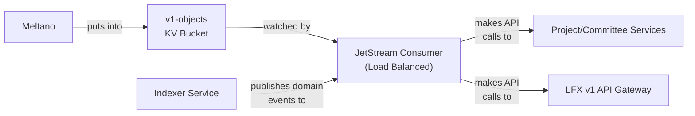

# LFX v1 Sync Helper

The LFX v1 Sync Helper is a Go microservice that synchronizes data between LFX v1 and LFX One (v2). It syncs v1 data from NATS KV buckets into v2 services via authenticated API calls, and also makes authenticated API calls back to LFX v1 endpoints to keep v1 in sync with changes originating in v2. It uses a JetStream consumer-based architecture that enables horizontal scaling across multiple service instances for processing v1 data updates.

## Architecture Overview

### Key implementation decisions

1. **KV Bucket Watcher**: Instead of consuming NATS messages directly from streaming data sources, this service watches a NATS KV bucket (`v1-objects`) where v1 data is written by replication jobs (e.g. Meltano)
2. **Direct API Calls**: Core resources (projects, committees) are synced via LFX One API services. Records owned by external wrapper services (e.g. meetings, voting, surveys) and records consumed directly from the `v1-objects` KV bucket by other services (e.g. `salesforce_b2b-*`) are passed through without API calls.
3. **JWT Authentication**: Reuses Heimdall's signing key to create JWT tokens for secure API authentication, supporting user impersonation while also bypassing LFX One permissions—as Heimdall tokens are not just proof of authentication, but are of *authorization*.
4. **Mapping Storage**: Maintains v1-to-v2 ID mappings in a dedicated NATS KV bucket to track state and to avoid introducing "legacy ID" fields in LFX One data models.

### Data Flow

For a more detail view, see the root [README.md](../../README.md) diagrams.



## Horizontal Scaling

The service is designed to scale horizontally across multiple instances using a JetStream consumer with delivery groups:

### Scaling Architecture

Retrieving updates from the KV Bucket handled via a non-ephemeral **JetStream pull consumer**. This has the advantage over an ordinary `kv.Watch()` of distributing messages across multiple instances, similar to how other LFX One services use named queues to scale out processing.

The service attempts to create a JetStream pull consumer with the following properties, if it does not already exist (created by the Helm chart, for instance):

```yaml
name: v1-sync-helper-kv-consumer
stream: KV_v1-objects
filterSubject: "$KV.v1-objects.>"
ackPolicy: explicit
maxDeliver: 3
ackWait: 30s
maxAckPending: 1000
```

### Supported Objects

#### v1 → v2 (KV bucket watch)

- **Projects**: LFX project nested hierarchy (PCC / Salesforce)
- **Committees & members**: LFX committees (PCC)

#### v2 → v1 (indexer domain events)

The app reconciles the durable `v1-sync-helper-committee-events-consumer` on
`committee_events` at startup, including existing consumers. Committee, member
and settings events have a **65-second total processing deadline**, allowing the
v1 API's 60-second timeout plus five seconds of overhead. The consumer's
**90-second AckWait** leaves room to ACK/NAK after processing finishes without
redelivering an operation still in flight. The three-delivery limit, subjects and
durable checkpoint are unchanged; restarting does not replay historical events.
Each replica pulls only **one message at a time**: the next event stays on the
server rather than consuming its AckWait in a client buffer behind a slow call.
Multiple replicas can still process different events concurrently; the shared
consumer's `MaxAckPending` remains 100. All replicas must run the updated image
for this per-replica delivery bound to apply throughout the deployment.
Other consumers retain their own acknowledgement windows.

Graceful shutdown allows **75 seconds** for the NATS connection to drain, followed
by up to **5 seconds** for pending dual-store mapping writes. The Helm app's pod
grace period defaults to **120 seconds**; update any shorter environment override
along with the application image. The processing budget covers the whole event,
including authentication and lookups, not a fresh 65 seconds for each HTTP call.
Longer budgets alone cannot resolve ambiguous create success followed by 409;
the guarded helper-side recovery below handles that case without repeating POST.

|NATS Subject|Action|
|---|---|
|`lfx.committee.created`|Create committee in v1 via Project Service API|
|`lfx.committee.updated`|Update committee in v1 via Project Service API|
|`lfx.committee.deleted`|Delete committee in v1 via Project Service API|
|`lfx.committee_settings.created`|Sync current business-email requirement to v1|
|`lfx.committee_settings.updated`|Sync current business-email requirement to v1|
|`lfx.committee_member.created`|Add member to committee in v1 via Project Service API|
|`lfx.committee_member.updated`|Update committee member in v1 via Project Service API|
|`lfx.committee_member.deleted`|Remove member from committee in v1 via Project Service API|

Create-loop detection skips creates with a live reverse mapping. Update echoes use
pending-operation markers; v1 WAL echoes of v2 writes are skipped by the sync
client's `lastmodifiedbyid` identity.

#### Guarded recovery of committee creates

Before a new committee POST, the helper confirms the current V2 identity through
the base API and project/name lookup, checks a primary v1 database snapshot for
same-name records (including deleted records), and insert-only claims
`create_attempt.committee.<v2-uid>` through the configured `MappingStore`.
This versioned attempt stores an operation ID, resolved project/parent IDs,
database-clock start time, and SHA-256 fingerprints of the normalized create payload and service
creator. It does **not** retain the raw payload or creator principal.
Parent-clearing `NONE` is normalized to no parent on create; it remains a
clearing instruction on PATCH only.
New attempts use version 3 with `prepared` and `dispatched` phases. Validation,
mapping-read and snapshot failures before dispatch can retry the same prepared
attempt. A CAS transition immediately before POST selects one dispatcher and
refreshes the database-clock creation window. A failed/uncertain dispatch write
never permits POST; an already-dispatched attempt is never reset. Version-1/2
dispatched attempts remain conservative: unknown outcomes require manual review,
not retrospective assignment of new ownership evidence. A version-2 preparation
can acquire the new scope under CAS because it has not dispatched.
Only the dispatch-CAS winner can send POST. The database clock defines the creation
window; it is not compared with the V2 creation date or the current wall clock.
If a candidate appears during the final pre-dispatch snapshot, re-read the
attempt before rejecting it. An advanced revision for the same operation remains
pending recovery (delayed NAK); an unchanged attempt or different identity remains
a manual conflict. Re-read failures stay retryable rather than being ACKed.

Each new attempt also insert-only claims
`create_scope.committee.<sha256(project-id, database-normalized-name)>`, retaining
the owning V2 UID and operation ID, not the raw name. The primary snapshot returns
the same `LOWER(name)` normalization used in candidate selection. Different UIDs
cannot dispatch or adopt through the same scope, even after an owner's deletion.
Scopes never expire or transfer automatically: a delayed predecessor commit can
otherwise pass another UID's overlapping creator/time/payload checks. Legitimate
name reuse needs explicit manual reconciliation and a reviewed scope handoff.

**Scoped-adoption rollout gate:** `COMMITTEE_SCOPED_ADOPTION_ENABLED` defaults to
`false`. Fresh scope-fenced POSTs and known returned IDs still work, but ambiguous
adoption stays manual until operators have upgraded every writer, reconciled all
older unscoped outstanding attempts, and established that no older create can
still commit. Only then enable the flag. Waiting 70 seconds or observing an empty
snapshot alone is not that evidence. The flag is an explicit rollout attestation,
not automatic proof; it never permits adopting a legacy unscoped unknown result.
This avoids laundering an old unresolved request through a newly claimed scope.

After a timeout, unreadable response, 409 or other ambiguous failure, the helper
retains the attempt and NAKs with a **70-second delay**. A fresh delivery performs
read-only recovery instead of POSTing again. Automatic adoption requires exactly
one same-project/name candidate, created by this helper during the recorded
65-second create window, unchanged since creation, not deleted, with **no member
history**, and with a matching normalized original payload (including parent,
visibility, voting and business-email fields). Known server-derived SSO/public
name semantics and false boolean defaults are normalized, not fuzzy-scored.
Missing/unavailable snapshots remain retryable; replica snapshots cannot authorize
creation or recovery. A genuinely pre-existing group, competing name owner,
changed request, unknown attempt format or unverifiable candidate requires manual
reconciliation. Permanent decisions are ERROR-logged with the object ID and ACKed;
exhausted retry deliveries also emit an explicit manual-reconciliation error.

The returned/recovered v1 ID is CAS-recorded before mapping claims. Forward and
reverse mappings are create-only: matching entries are accepted; conflicting
entries and tombstones are never overwritten. Both directions are re-read before
success. A recorded ID permits replay to complete a partial pair, including a
missing forward key behind the normal reverse-mapping loop guard. A tombstoned
committee is never recreated by a late create event. All attempt/mapping writes
use the existing KV/dual/Postgres store abstraction; no v1 write endpoint or
database schema change is required.

Member-created events whose parent has a recorded attempt also use delayed retry
within the existing three-delivery limit while the committee mapping is pending.
Child committee creates use the same delay for a missing parent mapping with a
valid same-project create attempt; deleted/tombstoned or conflicting parents do
not become eligible for creation. Untracked missing parents retain ordinary retry
behavior, and transient attempt-store failures remain retryable.
Proven V2-only/untracked parents keep their existing permanent-skip behavior.
Before a member POST, the helper fetches the current V2 member and uses its
current fields, not the delayed event body. NotFound retains deletion intent
and skips creation; transient reads retry. Member creates insert-only claim
`create_attempt.committee_member.<v2-uid>` before POST and CAS-record only the
resolved IDs on success (no profile fields). Replays complete partial mapping
claims or cleanup from that result, never another POST. Unlike committees,
ambiguous member outcomes have no automatic database-adoption path: they retry
within the delivery budget and then require manual reconciliation.

V2 committee/member deletes first retain a permanent
`create_deleted.<resource>.<v2-uid>` fence, including when no reverse mapping
exists yet. Completion checks it before and after mapping claims; a racing
delete reads the recorded create result. Known results are deleted through the
existing v1 API and their mappings tombstoned, with ownership conflicts left
untouched for manual review. Cleanup failures retry from retained IDs. Unknown
results remain fenced and visibly require manual cleanup on retry exhaustion;
deletion never authorizes adopting an arbitrary same-name candidate. These
fences and attempts must not be expired or reset to force a new POST.

**Member cleanup replay:** v1 member DELETE addresses a reusable contact ID,
not an immutable membership record. Fully tombstoned old mappings or a completed
`cleanup_attempt.committee_member.<uid>` therefore skip DELETE. Before a first
DELETE, a bounded primary snapshot checks the original record and active
committee/contact memberships. An absent/deleted original or a replacement only
requires tombstoning the old owner's mappings, not deleting the current contact.
Duplicate or changed ownership, a missing original record ID, and legacy partial
cleanup without a confirmed result fail closed for manual review.

An insert-only cleanup record binds the resolved IDs by fingerprint and fences
dispatch. A confirmed DELETE is CAS-recorded **before** mapping tombstones; retries
then only finish owner-checked CAS tombstones and record completion. A failed or
lost DELETE response, or uncertain persistence of its confirmed result, never
authorizes another DELETE: the retained `dispatched` phase retries waiting for
the original worker, then surfaces manual reconciliation on exhaustion. Read or
storage failures before dispatch remain safely retryable. Do not clear cleanup
attempts to force another DELETE. This is helper-side fencing and primary-read
verification, not a conditional-delete guarantee against external v1 writers.

This is not a historical backfill: member events
whose deliveries were already exhausted are not automatically replayed, and old
unmapped committees without recorded attempts are not adopted by name.

**Rollout and operations:** the existing v1 database connection must be a primary
read source and permit SELECT on `platform.collaboration__c` and
`platform.community__c`. API `CreatedBy: System`, cached rosters and replica
absence are not ownership evidence. The committee service must serve the existing
`lfx.committee-api.name_to_uid` lookup. Roll every helper replica to the new image;
older writers do not honor attempt fences. Attempts are intentionally retained,
not expired: an unavailable/missing result, or even failure to confirm the attempt
write, does not prove a previous POST can never commit. Do not clear an attempt to
force another POST without first reconciling its actual v1 outcome. Recovery only
links the verified record; it does not overwrite its fields or replace a roster.

Recovery compares current normalized committee base/settings fields with the
original request fingerprint, before dispatch/adoption and around mapping claims.
This detects voting, visibility and other edits ACKed while the reverse mapping
was absent. Drift is explicitly surfaced for manual reconciliation, not accepted
as successful stale adoption or automatically PATCHed over a candidate. Recorded
committee deletion uses owner-checked CAS tombstones after DELETE; an ownership
change during the HTTP call is preserved and surfaced rather than overwritten.

Member mapping recovery re-reads current v1-writable V2 fields after claiming
ownership, and performs a retryable PATCH without another POST or consuming an
indexer echo marker. Replays always reconcile, including when a previous PATCH
response was lost. A hash of the initial update-shaped payload (no profile data)
only avoids an unnecessary PATCH on an unchanged first create; it is not cached
proof of v1's later state. Ownership/deletion are rechecked around reconciliation,
and an edit during the PATCH causes another current-state retry. Cleared role and
voting fields use the existing v1 sentinels/date-clear contract.
Before recovery claims and before/after any reconciliation PATCH, the same bounded
primary-record check used by cleanup must prove that the original record ID is
the unique active membership for that committee/contact. Missing, deleted,
replaced or ambiguous originals fail closed without PATCH; replica/unavailable
reads retry. Mapping ownership and live V2 state alone are not sufficient while
WAL catches up. These checks detect known replacements; they do not provide an
atomic conditional-PATCH guarantee against external v1 writers.

#### Committee business-email requirement

`business_email_required` lives in v2 committee **settings**, not the base record.
v1 updates therefore perform a separate, ETag-protected settings read/update,
including when no committee-base field changed. Other scalar settings are
preserved and writer/auditor lists are omitted, so the service leaves them alone.
Each settings sync re-reads the current v1 replica record, rather than trusting
an old WAL delivery. Every existing-committee update also refreshes base input
before base work, including absent/null-flag events, so a retried base or settings
failure cannot revert a newer committee rename. Echo detection uses the original
WAL message's editor, not the refreshed row's editor: a settings-only PATCH can
make a pending human rename service-authored without syncing it. Normal base
comparison skips already-completed work without discarding pending changes.
Deleted/missing records or an absent/malformed flag do not
change v2 settings; replica read failures are retried. Transient base failures
also retry instead of acknowledging the settings change without processing it.
Successful base bookkeeping and SSO-name writeback complete before settings
sync, so a settings failure cannot bypass those steps.
A v2 settings NotFound is INFO-logged and skipped; retries cannot create the
missing settings record. Other settings failures continue to retry.

For v2-created committees, current settings are read before creating the v1
record. A missing settings record uses the v1 default only after confirming
that the v2 base still exists; a deleted base is skipped. Later settings
create/update events PATCH only `BusinessEmailRequired`
in v1, using current v2 state rather than a stale event snapshot. Missing reverse
mappings are retried with a 70-second delay (up to the existing three deliveries)
only when the live committee's parent project has a live v1 mapping. This allows
an in-flight base create to finish without retrying settings on proven v2-only
committees. Settings deletes and tombstoned mappings
never produce a PATCH. Settings have their own pending-marker namespace so a
settings echo cannot consume the committee-base marker. Create markers are
separate from update markers, so an immediate v2 settings edit is not swallowed
by the pending echo of a v1 create.

**Deployment:** the `committee_events` stream must include
`lfx.committee_settings.>` before starting the updated consumer. The Helm chart
adds this subject; installations managing the stream separately or overriding
its subjects must add it themselves. Existing historical drift is not replayed
or repaired automatically. Confirm each mismatched record's intended value
before rollout; subsequent events can now propagate changes in both directions.

#### Committee member role and term dates

Member create and update events (including coordinated bulk adds, which publish
the same per-member event) map `role` to v1 `Role`, `RoleStartDate` and
`RoleEndDate`. Two role shapes are accepted:

- **Structured** `{"name", "start_date", "end_date"}`, as committee-service emits
  it. It is a complete snapshot: an absent or null date is an empty date, and an
  empty name is sent as `None`. A missing or non-string name, or a date that is
  neither a string nor null, makes the whole object ignored, so it cannot clear
  anything.
- **Legacy string**: only the role name is sent; role dates are left alone.

On create, empty dates are omitted. On update, a structured role sends both dates,
with `""` for an empty date to clear it in v1. A legacy string sends only `Role`
and omits both role dates; an absent, null or malformed role omits every role
field. A present `voting` object likewise
sends both voting dates; an absent one omits them.

Member PATCHes (including `--reconcile-committee-member-voting`) send
`X-Preserve-Omitted-Dates: true`, so v1 keeps omitted dates instead of clearing
them (project-management#1540). Without that support, v1 clears every omitted
date on PATCH.

**Deployment:** deploy only after project-management#1540 is merged and its
header behavior is verified in the target environment; an HTTP 200 from an older
project-service does not prove support. Existing role/date drift is not repaired
automatically. Confirm each mismatched member's intended values before rollout,
since later structured snapshots overwrite v1 role dates.

## Configuration

### Environment Variables

| Variable                    | Required | Description                                                                       |
|-----------------------------|----------|-----------------------------------------------------------------------------------|
| `NATS_URL`                  | No       | NATS server URL (default: `nats://nats:4222`)                                     |
| `PROJECT_SERVICE_URL`       | Yes      | Project Service API URL                                                           |
| `COMMITTEE_SERVICE_URL`     | Yes      | Committee Service API URL                                                         |
| `HEIMDALL_CLIENT_ID`        | No       | Client ID for JWT claims (default: `v1_sync_helper`)                              |
| `HEIMDALL_PRIVATE_KEY`      | Yes      | JWT private key (PEM format) for v2 services                                      |
| `HEIMDALL_KEY_ID`           | No       | JWT key ID (if not provided, fetches from JWKS)                                   |
| `HEIMDALL_JWKS_URL`         | No       | JWKS endpoint URL (default: cluster service)                                      |
| `AUTH0_TENANT`              | Yes      | Auth0 tenant name (without .auth0.com suffix)                                     |
| `AUTH0_CLIENT_ID`           | Yes      | Auth0 client ID for v1 API authentication                                         |
| `AUTH0_PRIVATE_KEY`         | Yes      | Auth0 private key (PEM format) for v1 API                                         |
| `LFX_API_GW`                | No       | LFX API Gateway URL (default: `https://api-gw.dev.platform.linuxfoundation.org/`) |
| `DATABASE_URL`              | Yes*     | PostgreSQL DSN for the v1 platform database (live user lookups). *Alternatively set the discrete `V1_DB_*` variables below. |
| `V1_DB_HOST`                | Yes*     | v1 platform database host (used when `DATABASE_URL` is unset)                     |
| `V1_DB_PORT`                | No       | v1 platform database port (default: `5432`)                                       |
| `V1_DB_NAME`                | No       | v1 platform database name (default: `sfdc`)                                       |
| `V1_DB_USER`                | Yes*     | v1 platform database username (used when `DATABASE_URL` is unset)                 |
| `V1_DB_PASSWORD`            | Yes*     | v1 platform database password (used when `DATABASE_URL` is unset)                 |
| `V1_DB_SSLMODE`             | No       | PostgreSQL `sslmode` parameter (default: `prefer`)                                |
| `USE_MSGPACK`               | No       | Encode KV values as MessagePack instead of JSON (default: `false`)                |
| `DYNAMODB_INGEST_ENABLED`   | No       | Subscribe to DynamoDB stream events from `dynamodb-stream-consumer` (default: `false`). Requires the `dynamodb_streams` NATS stream to exist. |
| `DYNAMODB_STREAM_NAME`      | No       | NATS stream name to consume DynamoDB events from (default: `dynamodb_streams`)    |
| `MEMBER_SERVICE_URL`        | No       | Member Service API URL; required only for the `--backfill-acs-org` pass           |
| `PORT`                      | No       | HTTP server port (default: `8080`)                                                |
| `BIND`                      | No       | Interface to bind on (default: `*`)                                               |
| `DEBUG`                     | No       | Enable debug logging (default: `false`)                                           |

### Setting authentication parameters

The following script demonstrates how to set environment variables for both LFX v2 Heimdall impersonation and LFX v1 Auth0 authentication:

```bash
# LFX v2 Heimdall Authentication
# Optional - used for principal and subject claims (default: v1_sync_helper)
export HEIMDALL_CLIENT_ID="v1_sync_helper"
# Required - PEM formatted private key for signing JWTs
export HEIMDALL_PRIVATE_KEY="$(kubectl get secret/heimdall-signer-cert -n lfx -o json | jq -r '.data["signer.pem"]' | base64 --decode)"
# Optional - if not provided, fetches from JWKS endpoint
export HEIMDALL_KEY_ID="your-key-id"
# Optional - defaults to cluster service
export HEIMDALL_JWKS_URL="http://lfx-platform-heimdall.lfx.svc.cluster.local:4457/.well-known/jwks"

# LFX v1 Auth0 Authentication
export AUTH0_TENANT="linuxfoundation-dev"
export AUTH0_CLIENT_ID="your-auth0-client-id"
export AUTH0_PRIVATE_KEY="$(cat auth0-private-key.pem)"
# Optional - defaults to dev environment
export LFX_API_GW="https://api-gw.dev.platform.linuxfoundation.org/"
```

#### User impersonation logic

The service implements per-record user impersonation. JWT tokens for the same
identity will be reused within the same sync operation to minimize overhead for
token generation (and potentially for downstream validation, e.g. in the
indexer service).

**Machine User Impersonation** (when v1 `lastmodifiedbyid` has `@clients` suffix):
- **Principal**: `{client_id}@clients` (passed through verbatim)
- **Subject**: `{client_id}` (without @clients suffix)
- **Email**: Not included

**User Impersonation** (when v1 `lastmodifiedbyid` is User Service platform ID):
- Looks up user via LFX v1 User Service API: `GET /v1/users/{platformID}`
- **Principal**: `{username}` (from API response)
- **Subject**: `{username}` (same as principal)
- **Email**: `{email}` (from API response if available)
- **Caching**: User data cached for 6 hours (background-refreshed if older than 10 minutes)
- **Locking**: Prevents concurrent API calls for same user

**Fallback Client Mode** (when no principal or lookup fails):
- **Principal**: `v1_sync_helper@clients`
- **Subject**: `v1_sync_helper`
- **Email**: Not included

This approach ensures that v1 sync operations are properly attributed to the actual user who made the changes, with efficient caching to minimize API calls.

## Development

### Prerequisites

- Go 1.26+
- NATS Server with JetStream enabled
- Access to Heimdall JWT configuration

### Building

```bash
# Build the binary
make build

# Build with debug symbols
make debug

# Run all checks (format, lint, test)
make check

# Run the service
make run
```

## Deployment

### Kubernetes with Helm

See the Helm chart in `./charts/lfx-v1-sync-helper` for deployment configuration.

### One-shot administrative commands

The binary supports one-shot commands that exit after completing their task.

**`--backfill-acs-project`** — merges ACS user grants into v2 project settings (`Writers`, `Auditors`, `MeetingCoordinators`). Reads SFID→UID mappings from the `v1-mappings` KV bucket. Additive-only (never removes existing entries) and idempotent. Supports `--dry-run` to preview without writing.

**`--backfill-acs-org`** — merges ACS org grants (`company-admin` → `writer`, `viewer` → `auditor`) into v2 b2b_org settings. Reads live LF member org SFIDs from the `v1-objects` KV bucket (`salesforce_b2b-Account.*` keys, filtered to `IsDeleted=false` and `IsMember__c=true`). The b2b_org UID is the 18-char normalized SFID (`sfutil.Normalize18`) — no network round-trip. Requires `MEMBER_SERVICE_URL`. Additive-only and idempotent. Supports `--dry-run`. End-of-run summary includes: `orgs_total`, `orgs_changed`, `writers_added`, `auditors_added`, `orgs_skipped`, `errors`.

**`--backfill-workspaces`** — backfills legacy workspace data into v2 member service. Reads workspace and workspace_project records from the `v1-objects` KV bucket (`platform-organization_workspace.*` and `platform-organization_workspace_project.*` keys) and syncs them into v2 via the member service API. Requires `MEMBER_SERVICE_URL`. Additive-only and idempotent. Supports `--dry-run`. End-of-run summary includes: `workspaces_total`, `workspaces_created`, `workspaces_updated`, `workspaces_deleted`, `projects_added`, `projects_removed`, `workspaces_skipped`, `workspaces_errors`.

**`--backfill-projects`** — re-emits v1 `salesforce-project__c` rows with no live `project.sfid.*` v1-mappings entry (LFXV2-3220 removed the project allowlist; projects created before 17 Aug 2026 and never modified since were never synced) by re-PUTting the existing `v1-objects` value and letting the running deployment's KV consumer create them. Because that consumer unconditionally ACKs project messages and hard-errors on a missing parent mapping, candidates are re-emitted parent-before-child, level by level (`orderCandidatesByDepth`), rate-limited (`--emit-rate`, default 2.0/s) with a settle-poll between levels. Refuses to start a live run that mixes Formation-staged and non-Formation candidates unless `--exclude-stage-prefix`, `--include-stage-prefix`, or `--allow-formation` is passed. Aborts unless `--force` if live+tombstoned project mappings fall below the safety floor (~1000). Requires only NATS (`NATS_URL`, `AUTH0_CLIENT_ID`) — no v2 API calls. Supports `--dry-run` (candidate/ordering report only — cannot observe the downstream create) and `--limit` (0 = unlimited). End-of-run summary includes: `scanned`, `mappings_live`, `mappings_tombstoned`, `candidates`, `emitted`, `levels`, `formation_candidates`, `remaining_unmapped`, `errors`.

The flags are independent and mutually exclusive — run each as a separate Job invocation.

### Project staff reconciliation (lfx-self-serve#5034)

`--reconcile-project-staff-file` compares the executive director and program
manager of selected projects between LFX One (v2) and PCC (v1). It reports by
default and repairs v1 only for roles a reviewer approved. LFX One wins for an
approved role. There is no Job manifest: an operator runs it by hand, under the
gates below.

Creating or deploying this tooling authorizes nothing. A live run needs fresh
approval of the environment, the project cohort, the maintenance window and the
exact approved report.

#### Flags

| Flag | Meaning |
| --- | --- |
| `--reconcile-project-staff-file <path>` | Required. UTF-8 file of v2 project UIDs, one per line, in canonical UUID form. Blank lines and `#` lines are ignored, duplicates are dropped, more than 1000 projects is an error. |
| `--project-staff-report <path>` | New report file, created with mode `0600`. The run fails up front if the file exists. Required for a report run; optional with `--apply-project-staff`, where it records the apply results. |
| `--apply-project-staff` | Default `false`. PATCHes v1 for approved roles. Requires `--project-staff-approved-plan`. Rejected together with `--dry-run`. |
| `--project-staff-approved-plan <path>` | The reviewed report. Only accepted with `--apply-project-staff`. |
| `--emit-rate <n>` | Shared flag, default 2. At most `n` project PATCHes per second, one project at a time. The next PATCH waits at least `1/n` seconds after the preceding PATCH returns, so OAuth delays cannot refill a reserved slot. Apply requires at least `1/30` per second (use `0.03334` or faster), so the pacing interval fits the 30-second operation budget. |

The shared `--dry-run` flag (default `false`) never makes this command write:
without `--apply-project-staff` the run is report-only either way. Flag and file
errors exit `2` before configuration, NATS, Postgres or any API client is
touched. An approved plan whose `gatewayOrigin` differs from the configured
`LFX_API_GW` is rejected right after the configuration loads, before any client
starts.

The command needs the normal service configuration plus the v1 platform
database (`V1_DB_*`) for contact resolution, the JWT and Goa clients for v2
settings, and the v1 API client for the PATCH. It skips the Auth0 Management
client.

#### Mapping reads (no DDL)

The `project.uid.*` reverse mapping is read according to
`V1_MAPPINGS_STORE_MODE`, read-only:

- `kv` and `dual`: the existing `v1-mappings` KV bucket, which is authoritative
  in both modes. No Postgres pool is opened and no dual-write mirror worker
  starts.
- `postgres`: a pool without schema bootstrap, plus a catalog check that the
  `v1_mappings` table exists. A missing table fails the run; it is never created.

The command never writes a mapping and never calls `initMappingStore`.

#### Report schema (version 2)

Every entry is one project and role. The report holds no names, emails,
usernames, LFIDs, contact SFIDs, avatars, raw HTTP bodies or tokens. Approved
plans are decoded with unknown fields rejected. Synthetic example:

```json
{
  "schemaVersion": 2,
  "mode": "report",
  "gatewayOrigin": "https://api-gw.dev.platform.linuxfoundation.org",
  "fingerprintSalt": "aaaaaaaaaaaaaaaaaaaaaaaaaaaaaaaaaaaaaaaaaaaaaaaaaaaaaaaaaaaaaaaa",
  "summary": { "drift": 2, "in_sync": 1, "unresolved_contact": 1 },
  "entries": [
    {
      "projectUid": "11111111-1111-4111-8111-111111111111",
      "projectSfid": "a0941000002wSYNAAA",
      "role": "executive_director",
      "action": "assign",
      "outcome": "drift",
      "v2Etag": "7",
      "v1Revision": 40,
      "mappingRevision": 1,
      "targetFingerprint": "bbbbbbbbbbbbbbbbbbbbbbbbbbbbbbbbbbbbbbbbbbbbbbbbbbbbbbbbbbbbbbbb",
      "approved": false,
      "clearApproved": false
    },
    {
      "projectUid": "11111111-1111-4111-8111-111111111111",
      "projectSfid": "a0941000002wSYNAAA",
      "role": "program_manager",
      "action": "clear",
      "outcome": "drift",
      "v2Etag": "7",
      "v1Revision": 40,
      "mappingRevision": 1,
      "targetFingerprint": "cccccccccccccccccccccccccccccccccccccccccccccccccccccccccccccccc",
      "approved": false,
      "clearApproved": false
    }
  ]
}
```

- `action`: `assign` (LFX One has a person that resolves to a different v1
  contact) or `clear` (LFX One has nobody, PCC has someone).
- `v2Etag`, `v1Revision`, `mappingRevision`: the versions the comparison was
  made against. An apply refuses a role if any of them has changed.
- `fingerprintSalt`, `targetFingerprint`: a fresh random salt per report and a
  SHA-256 binding of the salt, project UID, role and resolved target. Apply
  refuses a drifted role as `stale_target` if contact resolution now selects
  a different target, even when every project version is unchanged. Salt and
  fingerprints are pseudonymous data, not anonymized identities; keep them
  private. The example fingerprints above are placeholders.
- Version 1 reports lack target bindings and are rejected. Generate and review
  a fresh version 2 report; do not upgrade an old approval by editing fields.
- `mode`: `report` or `apply`. Only a `report` file is accepted as an approved
  plan, so apply results cannot be replayed.

Report outcomes:

| Outcome | Meaning |
| --- | --- |
| `in_sync` | v1 already holds the resolved LFX One value. |
| `drift` | The values differ; `action` says what an approval would do. |
| `unresolved_contact` | LFX One has a person with no v1 contact (often a manual entry). Not repairable here, and never treated as a clear. |
| `ambiguous_contact` | The username or email matches more than one distinct live v1 contact. Nothing is written; an ambiguous username never falls back to email. Duplicate email rows for one contact are not ambiguous. |
| `no_project_mapping` | No live `project.uid.*` mapping. |
| `no_v1_record` | No live `salesforce-project__c` record in `v1-objects`. |
| `v2_project_not_found` | The project settings do not exist in v2. |
| `error` | A read failed (`reason`: `mapping_read_failed`, `v2_settings_read_failed`, `v1_record_read_failed`, `contact_lookup_failed`). The run exits `1`. |

#### Review and approval

1. Generate the report and review each `drift` entry in **both** PCC and LFX
   One. Decide per role. Leave PCC-wins and unclear roles unapproved; they need
   manual handling.
2. Set `"approved": true` only on roles LFX One should win. For a `clear`, also
   set `"clearApproved": true`, otherwise the role is skipped as
   `clear_not_approved`.
3. Do not edit any other field. The plan is rejected for an unsupported schema
   or role, an unknown field, `clearApproved` on anything but an approved clear,
   an approved project missing from the selection file, an approved entry
   without its versions or target fingerprint, a missing/invalid salt, or
   conflicting duplicates.

#### Gates before an apply

The apply re-checks versions immediately before each PATCH, but the v1 PATCH has
no compare-and-swap and the v1 comparison source is the replicated `v1-objects`
bucket. A named operator must confirm, before running it:

- [ ] An edit freeze on the selected projects in both PCC and LFX One, approved
      by the project owner, for the whole window.
- [ ] Replication has settled: no in-flight PCC edits are still on their way
      through WAL to `v1-objects`, and no staff bridge events are in flight.
- [ ] This is the only repair writer. One event-consumer replica does not rule
      out a second repair run or a PCC edit.
- [ ] The approved report was generated against this environment and is the
      one that was reviewed.

If any of these cannot be confirmed, run report mode only.

#### Signed-origin rollout gate

The [project staff bridge contract](../../README.md#project-staff-sync-gh-1802)
uses a signed `lfx_origin` JWT claim and the project-service SDK's optional event
`origin` field to suppress relayed v1 changes without erasing the human actor.
This is not a new source-of-truth policy or a replacement for the apply gates.

Before relying on origin-aware echo suppression:

1. Release the project-service SDK containing `OriginClaim`,
   `OriginV1SyncHelper` and `ProjectSettingsUpdatedMessage.Origin`; pin the bridge
   to the real published version. Local cross-repo module overrides are verification
   aids only, not a released SDK or deployable dependency update.
2. With the staff-edit freeze and a single enabled consumer, deploy origin-aware
   project-service code to **all** replicas, then replace **all** old bridge
   processes with the origin-signing/consuming version. Do not resume writes during
   a mixed rollout; old producers or validators still emit unclassifiable events.
3. Confirm no in-flight old requests/settings events remain and WAL replication
   has settled before lifting the freeze. Keep the existing pod-transition freeze:
   pending-write memory is per process and is lost on restart.

Absent/empty origins retain legacy comparisons, and unknown event values are not
treated as v1. They cannot reliably distinguish a PCC echo from a genuine LFX One
reversal by that same human. Legacy echoes can still move v1 audit attribution or
overwrite a newer PCC assignment, not merely send a harmless same-value PATCH.
Keep NATS publishing restricted to trusted producers; the copied event field is
not itself a signature. A rollback to old bridge/service code restores these
legacy risks and requires the same freeze/settle posture.

No SDK release, deployment, live repair, or historical replay is implied by source
changes or local tests. The v1 PATCH still has no CAS, so the apply freeze and
single-writer requirements above remain mandatory even after complete rollout.


#### Running it

Synthetic paths; the selection file holds only project UIDs.

```sh
# 1. Report (reads only).
lfx-v1-sync-helper --reconcile-project-staff-file cohort.txt \
  --project-staff-report staff-report.json

# 2. Review in PCC and LFX One, copy the report, set approvals.
cp staff-report.json staff-approved.json   # edit approved / clearApproved only

# 3. Apply, during the freeze.
lfx-v1-sync-helper --reconcile-project-staff-file cohort.txt \
  --apply-project-staff --project-staff-approved-plan staff-approved.json \
  --project-staff-report staff-apply-results.json

# 4. Confirm with a fresh report.
lfx-v1-sync-helper --reconcile-project-staff-file cohort.txt \
  --project-staff-report staff-report-after.json
```

Each project's re-reads, pacing wait and PATCH request share a 30-second
context deadline. The minimum rate only ensures the pacing interval can fit
that budget; slow reads can still exhaust it.

OAuth token acquisition has a separate 20-second timeout. The production
token source fetches synchronously, and the request context cannot interrupt
it. Budget up to about 50 seconds for a project operation to return if token
acquisition starts near the operation deadline (30 seconds plus the independent
20-second allowance). Cancellation can likewise wait for an in-flight token
fetch to finish.

After a successful PATCH, a separate convergence poll waits on `v1-objects`
for up to 60 seconds until the new values have replicated.

Apply outcomes:

| Outcome | Meaning | Next step |
| --- | --- | --- |
| `patched` | v1 PATCHed and the change replicated. | None. |
| `now_in_sync` | Already equal at re-check time. | None. |
| `clear_not_approved` | Approved clear without `clearApproved`. | Approve explicitly if intended. |
| `stale_mapping`, `stale_v2`, `stale_v1`, `stale_action`, `stale_target` | A project version, action or resolved contact changed since the review. Nothing written. | Fresh report and review. |
| `unresolved_contact`, `no_v1_record`, `v2_project_not_found` | The project cannot be compared any more. Nothing written. | Investigate, then a fresh report. |
| `ambiguous_contact` | A reviewed identifier now has multiple live contact owners. Nothing written, even if the recorded project versions are unchanged. | Resolve the ambiguity manually, then generate and review a fresh report. |
| `v1_project_not_found` | v1 returned 404 (platform-native project). | None in v1. |
| `rejected` | v1 returned another 4xx (`reason`: `http_<status>`). Nothing written. The run continues. | Investigate. |
| `patched_unconverged` | The PATCH succeeded but `v1-objects` did not show it within the window. | Fresh report after replication settles. |
| `unconfirmed` | Timeout, transport error or 5xx: v1 may or may not have written. **The run stops.** | Check the project in PCC and LFX One, then a fresh report and review. Never re-run the old approval. |
| `not_attempted` | No PATCH sent because the operation/pacing budget was exhausted, an earlier project stopped the run, or the run was cancelled. | Fresh report and review; check the rate and read latency if pacing exhausted the budget. |
| `error` | A re-read failed. Nothing written. | Fresh report. |

The run exits `0` only when every approved role ended `patched`, `now_in_sync`
or `clear_not_approved`; otherwise it exits `1`. Logs carry only project UIDs,
roles, outcome and reason codes, and counts. Keep reports out of tickets, docs
and chat.

#### Verification

After the freeze, check the repaired roles independently in PCC and in LFX One,
then run a fresh report. Every approved role should be `in_sync`; any
unapproved or unresolvable drift is expected to remain. The staff bridge itself
is core NATS with no redelivery, so this command is also the recovery path for
an event dropped during an outage.

### Detecting committee parent drift (read-only)

`scripts/detect_committee_parent_drift.py` compares three **complete**, closely
timed CSV exports without connecting to or writing either system:

- `--v1`: `committee_sfid,parent_sfid` from live `platform.collaboration__c`
  rows (`sfid`, `committee_id`), including rows whose parent is null/empty.
- `--v2`: `committee_uid,parent_uid` from current v2 committee bases, including
  committees without a parent. Export the actual current bases, not index history.
- `--mappings`: `committee_sfid,committee_uid` from **live**
  `committee.sfid.*` v1-mappings entries; exclude tombstones (`!del`).

```sh
python3 scripts/detect_committee_parent_drift.py \
  --v1 v1-committees.csv --v2 v2-committees.csv \
  --mappings committee-mappings.csv > committee-parent-report.csv
```

The report includes matches, both-empty pairs, one-sided parents, different
parents, unmapped parents/committees, and missing records. It does not choose
which system wins; even a blank parent might be an intentional clear. Review
conflicts and establish a source-of-truth policy **before deploying** the
bidirectional parent writer: a subsequent full-snapshot v2 update can clear a
v1 parent when v2 has none, even if v2 was only missing that parent due to the
old sync omission. A v1 update carrying `committee_id` can likewise overwrite
a conflicting v2 parent. The script contains no repair/write path. Treat
exports and the report as operational data.

The existing `--backfill-committees` command repairs *unmapped committees*,
not parent links on already mapped committees. It does not depth-order nested
unmapped committees, so it must not be used as a hierarchy repair command.

In production, apply the Job manifest manually (not ArgoCD-managed). A dry-run pass is recommended first:

```sh
kubectl --context lfx-v2-prod -n v1-sync-helper apply -f manifests/backfill-acs-job.yaml
```

Locally:

```sh
lfx-v1-sync-helper --backfill-acs-project [--dry-run]
lfx-v1-sync-helper --backfill-acs-org [--dry-run]
```

### Required NATS KV Buckets

The service requires two NATS KV buckets:

1. **`v1-objects`**: Stores v1 objects from Meltano (10GB capacity)
2. **`v1-mappings`**: Stores v1-to-v2 ID mappings (2GB capacity)

These are automatically created by the Helm chart.

## API Integration

### JWT Token Generation

The service generates JWT tokens for each API call using PS256 algorithm:

- **Algorithm**: PS256 (RSA-PSS with SHA-256)
- **Key ID**: From config or JWKS endpoint
- **Issuer**: `heimdall` (fixed)
- **Subject**: varies per record (see User Impersonation Logic)
- **Principal**: varies per record (see User Impersonation Logic)
- **Email**: optional; varies per record (see User Impersonation Logic)
- **Audiences**: Service-specific (hardcoded, but varies per record)
  - Project Service: `lfx-v2-project-service`
  - Committee Service: `lfx-v2-committee-service`
  - Member Service: `lfx-v2-member-service`
- **Expiration**: 5 minutes

## Monitoring

### Health Endpoints

- **`/livez`**: Liveness probe (always returns OK while service is running)
- **`/readyz`**: Readiness probe (checks NATS connection status)

### Logging

The service uses structured JSON logging with the following levels:

- **ERROR**: Critical errors that require attention
- **WARN**: Non-critical issues (e.g., user lookup failures)
- **INFO**: Important operations (e.g., successful project creation)
- **DEBUG**: Detailed operation information (enabled with `DEBUG=true`)

### Key Log Fields

- `key`: KV bucket key being processed
- `operation`: KV operation type (PUT, DELETE)
- `slug`/`sfid`: Object identifiers
- `project_uid`/`committee_uid`: Generated V2 UUIDs
- `username`: Extracted from v1 `lastmodifiedbyid`

## License

Copyright The Linux Foundation and each contributor to LFX.

This project’s source code is licensed under the MIT License. A copy of the
license is available in LICENSE.

This project’s documentation is licensed under the Creative Commons Attribution
4.0 International License \(CC-BY-4.0\). A copy of the license is available in
LICENSE-docs.
